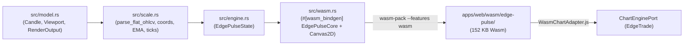

# 🏛️ Arquitectura — `edge-pulse-core` (`Bridge` Rust/Wasm)

> Actualizado: 2026-11-24 (`$edgepulse:archi`) | Estado: `🟢 CONGRUENTE` (5 tests `cargo test` OK + Wasm 152 KB en `apps/web/wasm/edge-pulse/`)

